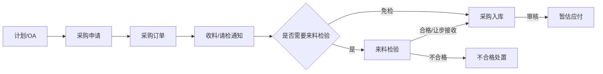
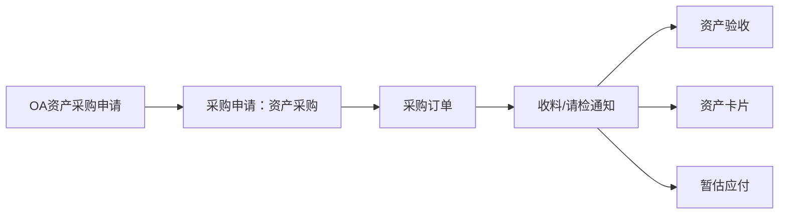
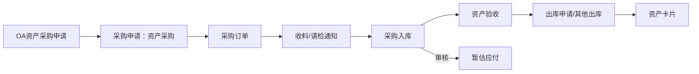
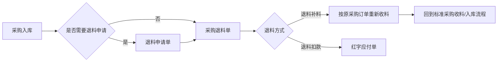
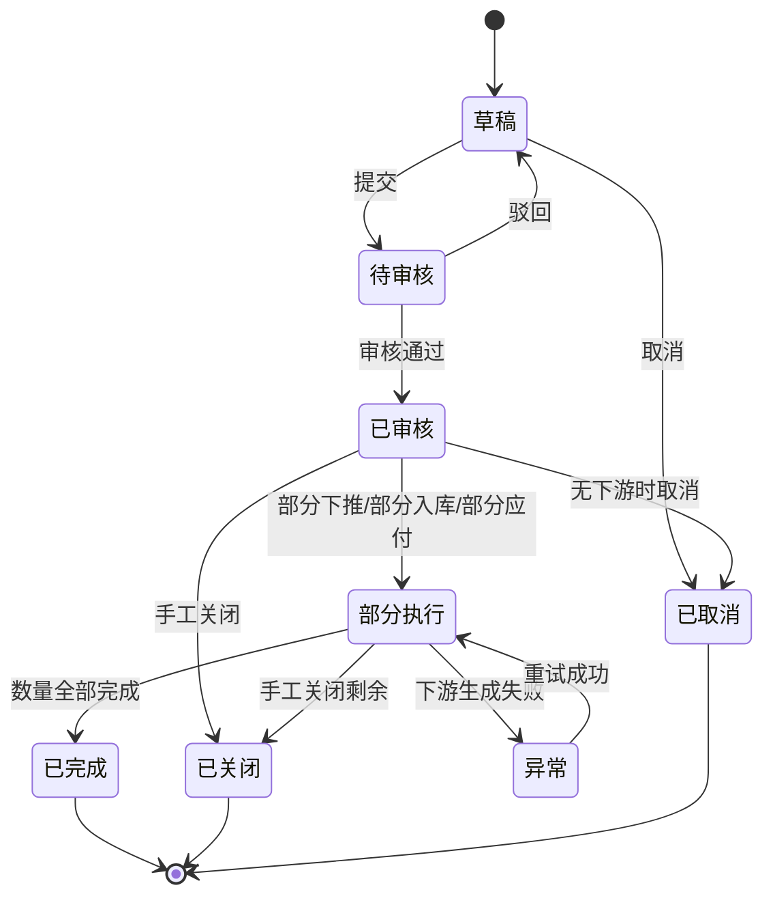

# 采购模块上下游边界与接口契约

> 文件路径：`/Users/dq/Documents/ERP/hub-erp-v0/采购模块上下游边界与接口契约.md`  
> 适用项目：`/Users/dq/Documents/ERP/hub-erp-v0`  
> 蓝图来源：`/Users/dq/Documents/ERP/2606 金蝶云星空业务蓝图 V1.0.docx` 中 `6.采购管理`  
> 辅助文档：`/Users/dq/Documents/ERP/hub-erp-v0/采购管理模块梳理.md`、`/Users/dq/Documents/ERP/hub-erp-v0/traewordp/需求文件及参考单据字段`  
> 当前状态：契约草案，需用户确认后再进入后端实现。  
> 强限制：本文件只约束采购管理模块及蓝图明确上下游接口，不扩展理想 ERP 功能，不引入重型架构，不重构非采购模块整体。

---

## 0. 总体结论

### 0.1 蓝图范围内采购流程

采购模块只覆盖蓝图 `CG-01、CG-06、CG-07、CG-08、CG-09、CG-10`：

| 蓝图编号 | 流程名称 | 是否纳入本次采购模块契约 | 说明 |
|---|---|---:|---|
| CG-01 | 采购整体业务流程 | 是 | 作为总体边界，不单独落新功能 |
| CG-06 | 标准采购流程 | 是 | 主链，优先实现 |
| CG-07 | 资产采购流程（不入库） | 是 | 扩展链，资产验收/资产卡片/暂估应付 |
| CG-08 | 资产采购流程（入库） | 是 | 扩展链，采购入库/资产验收/资产出库/资产卡片 |
| CG-09 | 费用采购流程 | 是 | 扩展链，服务/费用验收/暂估应付 |
| CG-10 | 采购退换货流程 | 是 | 扩展链，退料补料/退料扣款 |

### 0.2 当前代码现状判断

当前后端已存在基础模块：

| 模块 | 现有路径 | 判断 |
|---|---|---|
| 供应商 | `/Users/dq/Documents/ERP/hub-erp-v0/server/src/modules/supplier` | 可复用，作为采购主数据 |
| 采购申请 | `/Users/dq/Documents/ERP/hub-erp-v0/server/src/modules/purchase-request` | 需改造，当前偏单行明细结构 |
| 采购订单 | `/Users/dq/Documents/ERP/hub-erp-v0/server/src/modules/purchase-order` | 需改造，当前偏单行明细结构 |
| 库存入库 | `/Users/dq/Documents/ERP/hub-erp-v0/server/src/modules/inventory-in` | 可复用但需补采购入库契约字段/来源关系 |
| 来料检验 | `/Users/dq/Documents/ERP/hub-erp-v0/server/src/modules/quality-inspection` | 可复用但需明确来源收料通知、合格/让步/不合格数量 |
| 应付 | `/Users/dq/Documents/ERP/hub-erp-v0/server/src/modules/payable` | 可复用但需支持暂估应付、红字应付与幂等来源 |
| 固定资产 | `/Users/dq/Documents/ERP/hub-erp-v0/server/src/modules/fixed-asset` | 可复用但需明确资产采购生成资产卡片的最小接口 |

当前关键缺口：

1. 采购申请、采购订单需要升级为 **表头 + 多明细**。
2. 需要新增或补齐采购单据：
   - 收料/请检通知单；
   - 采购订单变更单；
   - 退料申请单；
   - 采购退料单；
   - 费用/资产验收单或最小验收记录；
   - 采购对账单。
3. 需要建立明细级来源关系、状态机、数量反写、幂等与异常补偿。
4. 不能只靠前端 localStorage/mock 形成闭环，必须以后端状态为准。

---

## 1. 采购模块边界声明

### 1.1 本模块负责

采购模块负责以下内容：

1. 供应商维度的采购业务单据流转。
2. 从采购需求生成采购申请。
3. 从采购申请下推采购订单。
4. 从采购订单下推收料/请检通知。
5. 根据收料/请检通知触发来料检验、采购入库、资产验收、费用验收。
6. 根据采购入库、收料通知、费用验收或退料单生成应付相关接口请求。
7. 根据采购退料流程生成补料或扣款处理。
8. 采购单据之间的来源关系、数量反写、状态流转、幂等控制。
9. 采购订单变更、采购对账、采购报表所需的采购侧数据。

### 1.2 本模块不负责

以下内容不由采购模块直接实现，只通过接口契约对接：

| 不负责内容 | 归属模块/系统 | 采购模块只做什么 |
|---|---|---|
| OA 审批流 | OA 系统 | 接收已审批结果，记录 `sourceSystem/sourceBillNo/sourceBillId` |
| 计划运算/MRP | 计划模块 | 接收计划投放的采购申请来源，不实现计划算法 |
| 库存台账与结存算法 | 库存模块 | 创建/提交/审核采购入库或退料出库请求，接收成功/失败结果 |
| 来料检验标准与不合格处置全过程 | 质量模块 | 创建来料检验单，接收检验结果与可入库数量 |
| 应付账款、付款、核销 | 应付/财务模块 | 生成暂估应付/红字应付来源请求，不处理付款核销 |
| 固定资产折旧、处置 | 固定资产模块 | 生成资产卡片创建请求，不处理折旧/报废/出售 |
| 权限体系、组织架构体系 | 系统基础模块 | 使用 `orgId/departmentId/applicantId/buyerId` 字段，不重做权限系统 |
| 复杂工作流引擎 | 暂不引入 | 使用单据状态机，不引入 BPM/消息队列/微服务 |

### 1.3 强制限制

1. 不允许新增蓝图未出现的采购业务链路。
2. 不允许采购模块直接改写非采购模块的内部账、库存、资产算法。
3. 不允许前端绕过后端状态直接改业务结果。
4. 所有下推必须保留来源单据头、来源单据行。
5. 所有生成下游单据的动作必须幂等。
6. 审核、下推、反审核、取消、关闭必须校验状态，不允许任意跳转。
7. 数量不得超源单可用数量，除非用户后续明确允许超收/超退规则。
8. 本阶段不引入微服务、消息队列、流程引擎、复杂权限平台。

---

## 2. 单据清单与数据模型方向

### 2.1 采购核心单据

| 单据 | 建议表头实体 | 建议明细实体 | 当前代码状态 | 说明 |
|---|---|---|---|---|
| 采购申请单 | `PurchaseRequest` | `PurchaseRequestEntry` | 已有单行式实体 | 必须改为表头 + 多明细 |
| 采购订单 | `PurchaseOrder` | `PurchaseOrderEntry` | 已有单行式实体 | 必须改为表头 + 多明细，补采购合同号 |
| 采购订单变更单 | `PurchaseOrderChange` | `PurchaseOrderChangeEntry` | 缺失 | 蓝图字段存在，建议作为扩展流程 |
| 收料/请检通知单 | `PurchaseReceiveNotice` | `PurchaseReceiveNoticeEntry` | 缺失 | 标准/资产/费用采购共用入口 |
| 来料检验单 | `QualityInspection` | 可沿用/补明细 | 已有 | 来源应固定为收料通知明细 |
| 采购入库单 | `InventoryIn` 或 `PurchaseInbound` | `InventoryInEntry` 或明细 | 已有单行式库存入库 | 建议复用 `inventory-in`，但需支持多明细和采购来源 |
| 退料申请单 | `PurchaseReturnRequest` | `PurchaseReturnRequestEntry` | `/Users/dq/Documents/ERP/hub-erp-v0/server/src/modules/purchase-return-request` | CG-10 可选前置，P1 已实现 |
| 采购退料单 | `PurchaseReturn` | `PurchaseReturnEntry` | `/Users/dq/Documents/ERP/hub-erp-v0/server/src/modules/purchase-return` | 支持补料/扣款，P1 已实现 |
| 采购对账单 | `PurchaseReconciliation` | `PurchaseReconciliationEntry` | 缺失 | 基于入库/退料/应付数据对账 |
| 资产验收单/记录 | `AssetAcceptance` 或采购侧验收记录 | `AssetAcceptanceEntry` | 缺失 | 可先做采购侧验收记录，资产卡片由资产模块生成 |
| 费用验收单/记录 | `ExpenseAcceptance` 或采购侧验收记录 | `ExpenseAcceptanceEntry` | 缺失 | 可先做采购侧验收记录，作为暂估应付来源 |

### 2.2 统一表头字段约束

采购类表头至少保留：

| 字段 | 类型/含义 | 是否必需 | 说明 |
|---|---|---:|---|
| `id` | 主键 | 是 | 继承 BaseEntity |
| `billNo` | 单据编号 | 是 | 按单据类型生成 |
| `billType` | 单据类型 | 是 | 标准采购、资产采购、费用采购等 |
| `businessType` | 业务类型 | 是 | 标准/资产不入库/资产入库/费用/退料补料/退料扣款 |
| `orgId` | 采购组织/业务组织 | 是 | 多组织字段，当前可先字段校验 |
| `departmentId` | 部门 | 视单据 | 申请部门/采购部门/退料部门 |
| `supplierId` | 供应商 | 订单及下游必填 | 采购申请可选建议供应商 |
| `billDate` | 单据日期 | 是 | 申请/订单/收料/入库/退料日期 |
| `status` | 单据状态 | 是 | 使用统一状态机 |
| `sourceSystem` | 来源系统 | 视来源 | `OA`、`PLAN`、`ERP` |
| `sourceBillType` | 来源单据类型 | 视来源 | 如 `OA_PURCHASE_REQUEST` |
| `sourceBillId` | 来源单据 ID | 视来源 | 外部来源可为空 |
| `sourceBillNo` | 来源单据编号 | 视来源 | 用于追溯 |
| `createdBy/updatedBy/auditedBy` | 操作人 | 建议 | 若当前 BaseEntity 不具备则补字段 |
| `createdAt/updatedAt/auditedAt` | 时间 | 建议 | 若当前 BaseEntity 不具备则补字段 |
| `remark` | 备注 | 否 | 采购备注 |

### 2.3 统一明细字段约束

采购类明细至少保留：

| 字段 | 类型/含义 | 是否必需 | 说明 |
|---|---|---:|---|
| `id` | 明细主键 | 是 | 需要明细级追溯 |
| `headerId` | 表头 ID | 是 | 关联表头 |
| `lineNo` | 行号 | 是 | 单据内唯一 |
| `materialId/materialCode/materialName` | 物料 | 标准/资产入库必填 | 费用采购可为服务项目/费用项目 |
| `spec` | 规格型号 | 否 | 来源字段文档中存在 |
| `unitId/unitCode/unitName` | 单位 | 是 | 数量单位 |
| `quantity` | 本单数量 | 是 | 申请/订单/收料/入库/退料数量 |
| `unitPrice` | 单价 | 视单据 | 订单/入库/应付相关必填 |
| `taxRate` | 税率 | 视单据 | 对账/应付需要 |
| `amount` | 不含税金额 | 视单据 | 可计算但建议存储 |
| `taxAmount` | 税额 | 视单据 | 可计算但建议存储 |
| `totalAmount` | 价税合计 | 视单据 | 可计算但建议存储 |
| `requiredDate/deliveryDate` | 需求/交货日期 | 视单据 | 申请/订单需要 |
| `warehouseId` | 仓库 | 标准/资产入库需要 | 费用/资产不入库不需要 |
| `sourceBillType/sourceBillId/sourceEntryId/sourceBillNo/sourceLineNo` | 来源行关系 | 下推单据必填 | 用于反写和追溯 |
| `orderedQty/receivedQty/inspectedQty/inboundQty/returnedQty/payableQty` | 累计数量 | 视单据 | 用于反写，不得只存头字段 |
| `closed` | 行关闭 | 建议 | 支持部分关闭 |

---

## 3. 上下游边界

### 3.1 上游来源

| 上游 | 蓝图依据 | 输入到采购模块 | 采购模块处理 | 不处理内容 |
|---|---|---|---|---|
| 计划运算 | CG-06：通过计划运算投放生成采购申请 | 采购申请来源数据 | 生成标准采购申请，记录 `sourceSystem=PLAN` | 不做计划算法 |
| OA 审批 | CG-06/07/08/09：OA 审批推送生成采购申请/预付申请 | 已审批采购申请、预付申请引用采购订单 | 生成采购申请或记录预付引用 | 不做 OA 审批流 |
| 供应商主数据 | 采购订单、收料、退料均涉及供应商 | 供应商 ID/编码/名称 | 校验供应商启用状态 | 不维护复杂供应商准入流程 |
| 物料/费用/资产基础资料 | 各采购明细 | 物料、资产类别、费用项目 | 校验基础资料存在并可用 | 不设计基础资料全生命周期 |

### 3.2 下游去向

| 下游 | 蓝图依据 | 触发点 | 采购模块输出 | 下游返回/结果 |
|---|---|---|---|---|
| 质量模块 | CG-06 收料通知下推来料检验 | 收料通知需要检验 | 创建来料检验单，来源为收料通知行 | 检验合格/让步/不合格数量 |
| 库存模块 | CG-06/08 采购入库 | 收料通知免检/合格/让步，或资产入库 | 创建采购入库单 | 入库审核结果、库存入账结果 |
| 应付模块 | CG-06/08 入库审核自动暂估；CG-07 收料通知暂估；CG-09 费用验收暂估；CG-10 退料扣款红字应付 | 下游单据审核成功 | 创建暂估应付/红字应付请求 | 应付单号、状态、失败原因 |
| 固定资产模块 | CG-07/08 生成资产卡片 | 资产验收或资产出库完成 | 创建资产卡片请求 | 资产卡片编号/状态 |
| 库存出库模块 | CG-08 资产领用出库；CG-10 采购退料出库 | 资产出库申请/采购退料单审核 | 创建其他出库/退料出库请求 | 出库结果 |
| 财务付款/核销 | 蓝图只提预付/应付流程 | 采购订单预付引用、应付单生成后 | 只记录采购订单可被 OA 预付引用 | 不处理付款核销 |

---

## 4. 流程契约

## 4.1 CG-06 标准采购主链

### 4.1.1 流程



### 4.1.2 单据转换规则

| 来源 | 目标 | 触发接口 | 前置条件 | 数量规则 | 幂等键 |
|---|---|---|---|---|---|
| 计划/OA | 采购申请 | `POST /api/purchase-requests/import` | 外部单据已审批/已投放 | 生成申请明细数量 | `sourceSystem + sourceBillNo + sourceLineNo` |
| 采购申请 | 采购订单 | `POST /api/purchase-orders/from-request` | 申请已审核，明细未关闭，可采购数量 > 0 | 订单数量 ≤ 申请可采购数量 | `targetBillType + sourceEntryId` |
| 采购订单 | 收料/请检通知 | `POST /api/purchase-receive-notices/from-order` | 订单已审核，明细未关闭，可收料数量 > 0 | 收料数量 ≤ 订单未收料数量 | `targetBillType + sourceEntryId + receiveBatchNo` |
| 收料通知 | 来料检验 | `POST /api/quality-inspections/from-receive-notice` | 收料通知已审核，需要检验，未生成检验或有剩余待检数量 | 检验数量 ≤ 收料未检数量 | `IQC + receiveNoticeEntryId` |
| 收料通知/检验结果 | 采购入库 | `POST /api/inventory-in/from-receive-notice` | 免检或检验合格/让步数量 > 0 | 入库数量 ≤ 免检/合格/让步可入库数量 | `PURCHASE_IN + receiveNoticeEntryId + inspectionId?` |
| 采购入库 | 暂估应付 | `POST /api/payables/from-purchase-inbound` | 采购入库已审核，应付未生成 | 应付数量/金额 = 入库已审核未应付数量/金额 | `ESTIMATED_PAYABLE + inventoryInEntryId` |

### 4.1.3 关键状态

| 单据 | 状态建议 | 说明 |
|---|---|---|
| 采购申请 | 草稿、待审核、已审核、部分下推、已下推、已关闭、已取消 | `已下推` 不等于关闭；可支持部分关闭 |
| 采购订单 | 草稿、待审核、已审核、部分收料、已收料、部分入库、已入库、已关闭、已取消 | 订单审核后才可收料 |
| 收料/请检通知 | 草稿、待审核、已审核、待检、检验中、可入库、部分入库、已入库、已关闭、已取消 | 标准采购主链关键新增单据 |
| 来料检验 | 待检、检验中、合格、不合格、让步接收、已关闭 | 只有合格/让步/免检可入库 |
| 采购入库 | 草稿、待审核、已审核、已生成暂估、已取消 | 审核后触发库存入账与暂估应付 |
| 暂估应付 | 未结算、部分结算、已结算、已冲销 | 采购模块只生成来源，不处理结算 |

### 4.1.4 数量反写规则

| 来源单据行 | 被反写字段 | 反写时机 | 回滚时机 |
|---|---|---|---|
| 采购申请行 | `orderedQty` | 采购订单审核或生效 | 采购订单取消/关闭时按规则回退 |
| 采购订单行 | `receivedQty` | 收料通知审核 | 收料通知取消/作废 |
| 收料通知行 | `inspectedQty` | 来料检验完成 | 检验单取消/作废 |
| 收料通知行 | `inboundQty` | 采购入库审核 | 入库单取消/红冲时按规则回退 |
| 采购订单行 | `inboundQty` | 采购入库审核 | 入库单取消/红冲时按规则回退 |
| 采购入库行 | `payableQty/payableAmount` | 暂估应付生成成功 | 应付冲销/删除时按规则回退 |

---

## 4.2 CG-07 资产采购流程（不入库）

### 4.2.1 流程



### 4.2.2 契约

| 来源 | 目标 | 触发接口 | 前置条件 | 说明 |
|---|---|---|---|---|
| OA | 采购申请 | `POST /api/purchase-requests/import` | OA 资产采购申请已审批 | `billType=ASSET_PURCHASE`，`businessType=ASSET_NO_INBOUND` |
| 采购申请 | 采购订单 | `POST /api/purchase-orders/from-request` | 申请已审核 | 不走库存入库 |
| 采购订单 | 收料通知 | `POST /api/purchase-receive-notices/from-order` | 订单已审核 | 到货后收料 |
| 收料通知 | 资产验收 | `POST /api/asset-acceptances/from-receive-notice` | 收料通知已审核 | 需求部门/财务验收 |
| 收料通知/资产验收 | 资产卡片 | `POST /api/fixed-asset/from-purchase` | 资产验收通过 | 资产模块返回资产编号 |
| 收料通知 | 暂估应付 | `POST /api/payables/from-asset-receive-notice` | 收料通知或资产验收已审核，具体需用户确认 | 蓝图写“根据收料通知下推生成应付单” |

### 4.2.3 限制

1. 资产不入库流程不得生成采购入库单。
2. 是否必须先资产验收再生成资产卡片，需要用户确认。
3. 是否必须先资产验收再生成暂估应付，需要用户确认。

---

## 4.3 CG-08 资产采购流程（入库）

### 4.3.1 流程



### 4.3.2 契约

| 来源 | 目标 | 触发接口 | 前置条件 | 说明 |
|---|---|---|---|---|
| OA | 采购申请 | `POST /api/purchase-requests/import` | OA 资产采购申请已审批 | `businessType=ASSET_INBOUND` |
| 采购申请 | 采购订单 | `POST /api/purchase-orders/from-request` | 申请已审核 | 与标准订单复用 |
| 采购订单 | 收料通知 | `POST /api/purchase-receive-notices/from-order` | 订单已审核 | 与标准收料复用 |
| 收料通知 | 采购入库 | `POST /api/inventory-in/from-receive-notice` | 收料通知已审核 | `inType=采购入库`，资产仓/指定仓 |
| 采购入库 | 资产验收 | `POST /api/asset-acceptances/from-inventory-in` | 入库已审核 | 需求部门验收 |
| 资产验收 | 出库申请/其他出库 | `POST /api/inventory-out/from-asset-acceptance` | 资产验收通过 | 出库申请/其他出库是否本次实现需确认 |
| 其他出库 | 资产卡片 | `POST /api/fixed-asset/from-inventory-out` | 其他出库已审核 | 资产模块生成卡片 |
| 采购入库 | 暂估应付 | `POST /api/payables/from-purchase-inbound` | 入库已审核 | 与标准采购一致 |

### 4.3.3 限制

1. 采购模块不处理资产折旧、报废、出售。
2. 采购模块仅传递生成资产卡片所需来源与金额。
3. 资产领用出库涉及库存出库模块，如现有后端缺失，只能做最小接口或待实现清单，不在采购模块内部硬编码库存扣减。

---

## 4.4 CG-09 费用采购流程

### 4.4.1 流程


### 4.4.2 契约

| 来源 | 目标 | 触发接口 | 前置条件 | 说明 |
|---|---|---|---|---|
| OA | 采购申请 | `POST /api/purchase-requests/import` | OA 费用采购申请已审批 | `businessType=EXPENSE_PURCHASE` |
| 采购申请 | 采购订单 | `POST /api/purchase-orders/from-request` | 申请已审核 | 明细可为费用项目/服务项目 |
| 采购订单 | 收料通知/服务完成记录 | `POST /api/purchase-receive-notices/from-order` | 订单已审核 | 费用采购不入库存，可用收料通知表示服务完成确认 |
| 收料通知/服务完成 | 费用验收 | `POST /api/expense-acceptances/from-receive-notice` | 服务完成/收料确认 | 需求部门验收 |
| 费用验收 | 暂估应付 | `POST /api/payables/from-expense-acceptance` | 费用验收已审核 | 不生成库存入库 |

### 4.4.3 限制

1. 费用采购不得生成库存入库。
2. 费用采购不得生成资产卡片。
3. 费用项目基础资料是否已有需后续确认；没有则以文本费用项目最小落地，不能扩展财务科目体系。

---

## 4.5 CG-10 采购退换货流程

### 4.5.1 流程



### 4.5.2 契约

| 来源 | 目标 | 触发接口 | 前置条件 | 数量规则 | 说明 |
|---|---|---|---|---|---|
| 采购入库 | 退料申请 | `POST /api/purchase-return-requests/from-inbound` | 入库已审核，存在可退数量 | 申请退料数量 ≤ 入库未退数量 | 退料申请可选 |
| 退料申请/采购入库 | 采购退料单 | `POST /api/purchase-returns/from-return-request` 或 `POST /api/purchase-returns/from-inbound` | 退料申请已审核或允许直接退料 | 退料数量 ≤ 申请未退/入库未退数量 | 退料方式：补料/扣款 |
| 采购退料单 | 库存退料出库 | `POST /api/inventory-out/from-purchase-return` | 退料单审核 | 出库数量 = 退料数量 | 若库存模块无接口，需新增最小出库接口 |
| 采购退料单 | 红字应付 | `POST /api/payables/from-purchase-return` | 退料单审核且退料方式=扣款 | 红字应付金额 = 退料扣款金额 | 幂等生成 |
| 采购退料单 | 收料通知 | `POST /api/purchase-receive-notices/from-return-replenish` | 退料单审核且退料方式=补料 | 补料数量 = 退料补料数量 | 按原采购订单继续标准采购链 |

### 4.5.3 限制

1. 采购退料单必须关联原采购入库行或原采购订单行。
2. 退料补料不得直接生成入库，必须重新走收料/必要检验/入库链路。
3. 退料扣款必须生成红字应付，不得直接修改原应付金额。
4. 是否强制先退料申请再退料单，需要用户确认。

---

## 4.6 采购订单变更

### 4.6.1 适用范围

采购订单变更只允许变更蓝图字段文档中出现的核心内容：

1. 采购数量；
2. 单价；
3. 交货日期；
4. 交货地点/仓库；
5. 备注；
6. 变更原因。

### 4.6.2 限制

1. 采购订单未审核时，允许直接编辑订单草稿。
2. 采购订单已审核后，不允许直接修改订单，必须通过采购订单变更单。
3. 新采购数量不得小于已收料数量/已入库数量。
4. 新单价影响后续未入库/未应付部分，已生成应付部分不得直接改价。
5. 变更单审核生效后，反写采购订单对应明细。

### 4.6.3 接口契约

| 接口 | 说明 |
|---|---|
| `POST /api/purchase-order-changes/from-order` | 从采购订单生成变更单 |
| `POST /api/purchase-order-changes/:id/submit` | 提交变更单 |
| `POST /api/purchase-order-changes/:id/approve` | 审核并生效变更 |
| `POST /api/purchase-order-changes/:id/cancel` | 取消未生效变更 |
| `GET /api/purchase-order-changes/order/:orderId` | 查询订单变更历史 |

---

## 4.7 采购对账

### 4.7.1 对账范围

采购对账只对蓝图采购链路已产生的业务结果做归集，不新建财务结算逻辑：

1. 已审核采购入库；
2. 已审核采购退料；
3. 已生成暂估应付；
4. 已生成红字应付；
5. 供应商、采购订单、期间、组织维度汇总。

### 4.7.2 接口契约

| 接口 | 说明 |
|---|---|
| `POST /api/purchase-reconciliations/generate` | 按供应商/组织/期间生成对账单 |
| `GET /api/purchase-reconciliations` | 查询对账单列表 |
| `GET /api/purchase-reconciliations/:id` | 查询对账单明细 |
| `POST /api/purchase-reconciliations/:id/confirm` | 确认对账 |
| `POST /api/purchase-reconciliations/:id/cancel` | 取消未确认对账 |

### 4.7.3 限制

1. 采购对账不得替代应付结算。
2. 对账单只引用采购入库、采购退料、应付单来源数据。
3. 对账差异处理方式需用户确认，未确认前只允许记录差异，不自动调账。

---

## 5. API 契约总览

> 说明：当前已有接口以现有路径为准；新增接口为采购蓝图闭环建议，用户确认后再实现。所有写接口必须返回统一结构：`{ success, data, message, traceId }`，失败必须返回明确业务错误码。

### 5.1 现有接口保留但需改造

| 模块 | 当前 Controller | 已有接口 | 改造方向 |
|---|---|---|---|
| 采购申请 | `/api/purchase-request` | CRUD、提交、审核、取消、关闭、更新已采购数量 | 建议统一为 `/api/purchase-requests` 或兼容旧路径；支持表头+明细、来源导入、下推订单 |
| 采购订单 | `/api/purchase-orders` | CRUD、提交、审核、取消、关闭、从申请生成 | 支持表头+明细、合同号、收料下推、订单变更 |
| 库存入库 | `/api/inventory-in` | CRUD、提交、审核、取消 | 支持采购入库多明细、从收料通知生成、审核后触发暂估应付 |
| 来料检验 | `/api/quality-inspections` | CRUD、审核、按来源查询 | 固定来源为收料通知，支持合格/让步/不合格数量回写 |
| 应付 | `/api/payables` | CRUD、付款 | 支持暂估应付/红字应付来源幂等创建 |
| 固定资产 | `/api/fixed-asset` | CRUD、折旧、处置 | 支持从资产采购来源生成资产卡片 |

### 5.2 建议新增采购接口

#### 5.2.1 采购申请

| 方法 | 路径 | 用途 | 关键校验 |
|---|---|---|---|
| `POST` | `/api/purchase-requests/import` | OA/计划导入采购申请 | 来源幂等，外部单据已审批/投放 |
| `POST` | `/api/purchase-requests/:id/submit` | 提交 | 草稿状态、至少一行明细 |
| `POST` | `/api/purchase-requests/:id/approve` | 审核 | 待审核状态 |
| `POST` | `/api/purchase-requests/:id/close` | 关闭 | 已审核/部分下推，关闭后不可下推 |
| `GET` | `/api/purchase-requests/:id/trace` | 来源去向追溯 | 返回下游订单/收料/入库/应付链 |

#### 5.2.2 采购订单

| 方法 | 路径 | 用途 | 关键校验 |
|---|---|---|---|
| `POST` | `/api/purchase-orders/from-request` | 采购申请下推采购订单 | 申请已审核，数量不超可下推 |
| `POST` | `/api/purchase-orders/:id/submit` | 提交 | 草稿状态、供应商、合同号按业务类型要求校验 |
| `POST` | `/api/purchase-orders/:id/approve` | 审核 | 待审核状态 |
| `POST` | `/api/purchase-orders/:id/close` | 关闭 | 已审核且无未处理异常 |
| `GET` | `/api/purchase-orders/:id/trace` | 订单全链追溯 | 返回申请、收料、检验、入库、退料、应付 |

#### 5.2.3 收料/请检通知

| 方法 | 路径 | 用途 | 关键校验 |
|---|---|---|---|
| `GET` | `/api/purchase-receive-notices` | 列表 | 支持供应商/订单/状态筛选 |
| `GET` | `/api/purchase-receive-notices/:id` | 详情 | 表头+明细 |
| `POST` | `/api/purchase-receive-notices/from-order` | 从采购订单下推 | 订单已审核，收料数量不超未收数量 |
| `POST` | `/api/purchase-receive-notices/:id/submit` | 提交 | 草稿状态 |
| `POST` | `/api/purchase-receive-notices/:id/approve` | 审核 | 待审核状态，审核后反写订单收料数量 |
| `POST` | `/api/purchase-receive-notices/:id/cancel` | 取消 | 未下游或按规则回退 |
| `POST` | `/api/purchase-receive-notices/:id/push-inspection` | 下推检验 | 需要检验，未检数量 > 0 |
| `POST` | `/api/purchase-receive-notices/:id/push-inbound` | 下推入库 | 免检/合格/让步可入库数量 > 0 |

#### 5.2.4 采购入库

| 方法 | 路径 | 用途 | 关键校验 |
|---|---|---|---|
| `POST` | `/api/inventory-in/from-receive-notices` | 从一张或多张收料通知生成采购入库 | 可入库数量 > 0，来源幂等；禁止混合普通收料与退料补料来源 |
| `POST` | `/api/inventory-in/:id/approve` | 审核采购入库 | 审核后库存入账，并触发暂估应付 |
| `POST` | `/api/inventory-in/:id/retry-payable` | 重试暂估应付 | 入库已审核且应付生成失败/未生成 |

#### 5.2.5 采购退料

| 方法 | 路径 | 用途 | 关键校验 |
|---|---|---|---|
| `POST` | `/api/purchase-return-requests/from-inbound` | 从采购入库生成退料申请 | 可退数量 > 0 |
| `GET` | `/api/purchase-return-requests`、`/api/purchase-return-requests/:id` | 查询退料申请 | 返回状态名称、来源链、申请/已退/可退数量 |
| `PUT` | `/api/purchase-return-requests/:id` | 修改退料申请 | 仅草稿/驳回；P1 不增删来源明细 |
| `POST` | `/api/purchase-return-requests/:id/submit` | 提交退料申请 | 草稿/驳回可提交 |
| `POST` | `/api/purchase-return-requests/:id/approve` | 审核退料申请 | 审核后可下推退料单 |
| `POST` | `/api/purchase-return-requests/:id/reject` | 驳回退料申请 | 仅待审核 |
| `POST` | `/api/purchase-return-requests/:id/cancel` | 取消退料申请 | 无下游时允许；释放已审核申请预留量 |
| `GET` | `/api/purchase-returns`、`/api/purchase-returns/:id` | 查询采购退料 | 返回状态、来源链、补料/红字应付结果 |
| `POST` | `/api/purchase-returns/from-return-request` | 从退料申请生成退料单 | 申请已审核 |
| `POST` | `/api/purchase-returns/from-inbound` | 直接从入库生成退料单 | 已确认允许跳过申请；不得占用已审核申请预留量 |
| `PUT` | `/api/purchase-returns/:id` | 修改采购退料 | 仅草稿/驳回；不得改变来源链 |
| `POST` | `/api/purchase-returns/:id/submit` | 提交采购退料 | 草稿/驳回可提交 |
| `POST` | `/api/purchase-returns/:id/approve` | 审核退料单 | 审核后按退料方式生成出库/红字应付/补料链 |
| `POST` | `/api/purchase-returns/:id/reject`、`/api/purchase-returns/:id/cancel` | 驳回/取消采购退料 | 驳回仅待审核；取消仅未审核 |
| `POST` | `/api/purchase-returns/:id/retry-payable` | 重试红字应付 | 退料扣款且应付失败 |
| `POST` | `/api/purchase-receive-notices/from-return-replenish` | 幂等生成补料收料通知 | 退料已审核且方式为补料 |

P1 补料边界：补料收料/入库分别反写采购退料明细累计量，不增加原订单普通 `receivedQty/stockedQty`；原订单 `APPROVED/FULLY_STOCKED` 均可继续补料链。补料采购入库来源标记为 `PURCHASE_RETURN_REPLENISH`，暂估应付状态为 `NOT_REQUIRED`，避免对同一采购义务重复立账。

#### 5.2.6 资产/费用验收

| 方法 | 路径 | 用途 | 关键校验 |
|---|---|---|---|
| `GET` | `/api/asset-acceptances`、`/api/asset-acceptances/:id` | 查询资产验收 | 返回 `status/statusCode/statusName`、来源链及下游生成状态 |
| `POST` | `/api/asset-acceptances/from-receive-notice` | 资产不入库验收 | 来源为资产采购不入库收料通知 |
| `POST` | `/api/asset-acceptances/from-inventory-in` | 资产入库验收 | 来源为资产采购入库单 |
| `PUT` | `/api/asset-acceptances/:id` | 修改资产验收 | 仅草稿/驳回；不得改变采购价格、税率和来源链 |
| `POST` | `/api/asset-acceptances/:id/submit\|approve\|reject\|cancel` | 资产验收状态动作 | 审核后不反审核；仅未审核单可取消 |
| `POST` | `/api/asset-acceptances/:id/generate-estimated-payable` | CG-07 生成/重试暂估应付 | 仅已审核资产采购不入库验收；幂等 |
| `POST` | `/api/asset-acceptances/:id/generate-asset-cards` | CG-07 生成/重试资产卡片 | 一物一卡；失败不回滚验收，允许幂等重试 |
| `GET/POST` | `/api/fixed-asset/categories` | 查询/创建资产类别 | 建卡折旧属性取启用的资产类别默认规则 |
| `GET` | `/api/asset-out-requests`、`/api/asset-out-requests/:id` | 查询资产出库申请 | 仅 CG-08；返回来源验收和数量状态 |
| `POST` | `/api/asset-out-requests/from-asset-acceptance` | 从资产验收生成出库申请 | 验收已审核且 `businessType=ASSET_INBOUND` |
| `PUT` | `/api/asset-out-requests/:id` | 修改资产出库申请 | 仅草稿/驳回；不允许修改来源数量 |
| `POST` | `/api/asset-out-requests/:id/submit\|approve\|reject\|cancel` | 出库申请状态动作 | 取消释放占用并允许重新创建；已下推不可取消 |
| `POST` | `/api/asset-out-requests/:id/push-inventory-out` | 下推其他出库 | 仅已审核申请；同键同载荷返回原单 |
| `POST` | `/api/inventory-out/from-asset-out-request/:requestId` | 其他出库兼容下推入口 | 仅生成 `outType=4` 的资产其他出库 |
| `POST` | `/api/inventory-out/:id/generate-asset-cards` | CG-08 生成/重试资产卡片 | 仅已审核资产其他出库；一物一卡、幂等 |
| `POST` | `/api/expense-acceptances/from-receive-notice` | 费用采购验收 | 来源为费用采购收料/服务完成 |
| `POST` | `/api/expense-acceptances/:id/approve` | 审核费用验收 | 审核后可生成暂估应付 |

#### 5.2.7 应付生成

| 方法 | 路径 | 用途 | 关键校验 |
|---|---|---|---|
| `POST` | `/api/payables/from-purchase-inbound` | 入库生成暂估应付 | 入库已审核，来源未生成过应付 |
| 内部接口 | `PayableService.createEstimatedPayableFromAssetAcceptance` | 资产不入库生成暂估应付 | 由资产验收审核或重试接口调用；一张验收一张暂估应付 |
| `POST` | `/api/payables/from-expense-acceptance` | 费用验收生成暂估应付 | 费用验收已审核 |
| `POST` | `/api/payables/from-purchase-return` | 采购退料生成红字应付 | 退料扣款已审核 |

---

## 6. 统一状态机约束

### 6.1 基础状态

建议采购单据统一使用以下状态语义，不要求所有单据都拥有全部状态：

| 状态码建议 | 状态 | 可编辑 | 可删除 | 可下推 | 说明 |
|---:|---|---:|---:|---:|---|
| 0 | 草稿 | 是 | 是 | 否 | 新建未提交 |
| 1 | 待审核 | 否 | 否 | 否 | 已提交 |
| 2 | 已审核 | 否 | 否 | 是 | 可作为来源 |
| 3 | 部分执行 | 否 | 否 | 是 | 部分下游完成 |
| 4 | 已完成 | 否 | 否 | 否 | 全部执行完毕 |
| 5 | 已关闭 | 否 | 否 | 否 | 人工关闭未完成部分 |
| 6 | 已取消 | 否 | 否 | 否 | 未产生不可逆下游才允许取消 |
| 7 | 异常 | 否 | 否 | 视情况 | 下游生成失败，允许重试/补偿 |

### 6.2 状态流转限制



### 6.3 禁止跳转

1. 草稿不得直接审核。
2. 已取消不得恢复，除非用户明确要求反取消机制。
3. 已完成不得直接删除。
4. 已审核且已有下游不得直接修改核心字段。
5. 已生成应付的入库/退料不得直接删除。

---

## 7. 来源关系与追溯契约

### 7.1 必须支持明细级来源

所有下推单据必须记录来源行：

```text
sourceBillType
sourceBillId
sourceBillNo
sourceEntryId
sourceLineNo
sourceSystem
```

仅有 `sourceId/sourceNo` 不够，必须能追溯到行级。

### 7.2 追溯链路

采购订单详情必须能追溯：

```text
采购申请行
→ 采购订单行
→ 收料通知行
→ 来料检验单/采购入库行
→ 暂估应付行
→ 退料申请行/采购退料行
→ 红字应付行/补料收料通知行
```

### 7.3 统一追溯接口

建议至少提供：

| 接口 | 用途 |
|---|---|
| `GET /api/purchase-requests/:id/trace` | 采购申请上下游追溯 |
| `GET /api/purchase-orders/:id/trace` | 采购订单上下游追溯 |
| `GET /api/purchase-receive-notices/:id/trace` | 收料通知上下游追溯 |
| `GET /api/inventory-in/:id/trace?sourceType=purchase` | 采购入库上下游追溯 |
| `GET /api/purchase-returns/:id/trace` | 退料上下游追溯 |

---

## 8. 幂等、并发与异常补偿

### 8.1 幂等规则

| 场景 | 幂等键 | 目标 |
|---|---|---|
| OA/计划导入采购申请 | `sourceSystem + sourceBillNo + sourceLineNo` | 防止重复导入 |
| 采购申请下推订单 | `targetBillType + sourceEntryId + supplierId` | 防止重复生成订单行 |
| 采购订单下推收料 | `targetBillType + sourceEntryId + receiveBatchNo` | 防止重复收料 |
| 收料通知下推检验 | `IQC + receiveNoticeEntryId` | 防止重复检验单 |
| 收料通知下推入库 | `PURCHASE_IN + receiveNoticeEntryId + inspectionId?` | 防止重复入库 |
| 入库生成暂估应付 | `ESTIMATED_PAYABLE + inventoryInEntryId` | 防止重复应付 |
| 入库下推退料申请 | 调用方 `idempotencyKey` + 规范化请求载荷 SHA-256 | 同键同载荷返回原单；同键不同载荷返回明确冲突 |
| 退料生成红字应付 | `RED_PAYABLE + purchaseReturnEntryId` | 防止重复红字应付 |
| 退料补料生成收料通知 | `REPLENISH_RECEIVE + purchaseReturnEntryId` | 防止重复补料 |

### 8.2 并发控制

1. 下推、审核、取消、关闭必须在事务中完成。
2. 反写来源数量时必须重新读取并校验可用数量。
3. 推荐增加 `version` 或 `updatedAt` 乐观锁字段。
4. 如果同一来源行并发下推导致数量超额，后提交者必须失败。
5. 所有失败必须返回业务错误码，不允许静默吞掉。

### 8.3 异常补偿

| 异常场景 | 推荐处理 | 是否阻断当前审核 |
|---|---|---|
| 采购入库审核成功但暂估应付生成失败 | 入库状态设为 `异常/应付生成失败`，记录失败原因，提供重试接口 | 需用户确认：阻断或允许异常后重试 |
| 退料单审核成功但红字应付生成失败 | 退料单状态设为 `异常/红字应付失败`，提供重试接口 | 需用户确认 |
| 收料通知审核后反写订单失败 | 整体事务回滚 | 是 |
| 入库审核后库存入账失败 | 整体事务回滚 | 是 |
| 资产卡片生成失败 | 验收/其他出库保持已审核，记录失败原因并提供幂等重试 | 否（用户已确认） |
| OA/计划重复推送 | 返回已有单据，不重复创建 | 否 |

---

## 9. 与现有代码的改造边界

### 9.1 允许改动范围

后续实现阶段允许改动：

```text
/Users/dq/Documents/ERP/hub-erp-v0/server/src/modules/purchase-request
/Users/dq/Documents/ERP/hub-erp-v0/server/src/modules/purchase-order
/Users/dq/Documents/ERP/hub-erp-v0/server/src/modules/supplier
/Users/dq/Documents/ERP/hub-erp-v0/server/src/modules/inventory-in
/Users/dq/Documents/ERP/hub-erp-v0/server/src/modules/quality-inspection
/Users/dq/Documents/ERP/hub-erp-v0/server/src/modules/payable
/Users/dq/Documents/ERP/hub-erp-v0/server/src/modules/fixed-asset
/Users/dq/Documents/ERP/hub-erp-v0/server/src/database/entities
```

允许新增采购蓝图内模块：

```text
/Users/dq/Documents/ERP/hub-erp-v0/server/src/modules/purchase-receive-notice
/Users/dq/Documents/ERP/hub-erp-v0/server/src/modules/purchase-order-change
/Users/dq/Documents/ERP/hub-erp-v0/server/src/modules/purchase-return-request
/Users/dq/Documents/ERP/hub-erp-v0/server/src/modules/purchase-return
/Users/dq/Documents/ERP/hub-erp-v0/server/src/modules/purchase-reconciliation
/Users/dq/Documents/ERP/hub-erp-v0/server/src/modules/asset-acceptance
/Users/dq/Documents/ERP/hub-erp-v0/server/src/modules/expense-acceptance
```

### 9.2 禁止改动范围

除非用户后续明确确认，禁止：

1. 重构整个 NestJS 项目结构。
2. 替换数据库、ORM、认证体系。
3. 引入微服务、消息队列、BPM 工作流。
4. 重写库存、应付、资产模块全部逻辑。
5. 大范围修改非采购前端页面。
6. 将 OA、计划、付款流程在本项目中完整实现。

### 9.3 建议后端实现顺序

| 阶段 | 范围 | 目标 |
|---|---|---|
| P0 | 标准采购主链 | 采购申请 → 采购订单 → 收料通知 → 检验/免检 → 采购入库 → 暂估应付 |
| P1 | 退换货 | 入库 → 退料申请/退料单 → 补料/红字应付 |
| P2 | 资产采购 | 资产不入库、资产入库、资产卡片接口 |
| P3 | 费用采购 | 费用申请、费用订单、费用验收、暂估应付 |
| P4 | 订单变更、对账、报表 | 订单变更单、对账单、执行分析 |

---

## 10. 前端对接边界

当前前端采购页面集中在：

```text
/Users/dq/Documents/ERP/hub-erp-v0/traewordp/pages/purchase-*.html
```

前端只负责：

1. 根据后端接口展示列表、详情、创建、编辑。
2. 调用后端提交、审核、下推、关闭、取消接口。
3. 展示后端返回的状态、可操作按钮、错误原因。
4. 不在前端自行计算最终业务状态。
5. 不使用 localStorage/mock 作为真实业务结果。

前端禁止：

1. 不重做 UI 风格。
2. 不引入 Vue/React/大型框架。
3. 不绕过后端状态机。
4. 不硬编码采购流程结果。

---

## 11. 用户待确认事项

以下问题需要用户确认后才能进入后端实现，尤其是会影响表结构、接口路径和异常处理策略的问题。

### A. 范围确认

1. 是否确认本次目标为 **完整蓝图采购模块**，覆盖 CG-06/07/08/09/10，而不是只做 P0 标准采购主链？
2. 是否确认按建议阶段实施：P0 标准采购主链 → P1 退换货 → P2 资产采购 → P3 费用采购 → P4 订单变更/对账/报表？

### B. 数据模型确认

3. 是否确认将采购申请、采购订单升级为 **表头 + 多明细**？这会对现有后端实体、DTO、前端提交结构产生较大改动。
4. 采购入库是否确认复用现有 `/api/inventory-in` 和 `InventoryIn`，并扩展为支持采购多明细与来源关系？还是新建采购入库专用实体？
5. 收料/请检通知是否确认作为采购模块独立单据 `purchase-receive-notice`？

### C. 主链规则确认

6. 采购订单中的【采购合同号】是否在标准采购中强制必填？资产/费用采购是否也强制？
7. 来料检验是否 P0 就必须打通，还是 P0 先支持免检/手动合格，P1 再完整接质量模块？
8. 是否允许部分收料、部分检验、部分入库、部分应付？ERP 通常应允许，但需要确认前端和报表是否同步支持。
9. 是否允许超收？如果允许，需要确认超收比例；未确认前默认不允许超收。

### D. 应付与异常确认

10. 采购入库审核生成暂估应付失败时，是 **阻断入库审核并回滚**，还是 **入库审核成功但标记应付生成失败并允许重试**？
11. 资产不入库流程中，暂估应付的触发点是 **收料通知审核**，还是 **资产验收审核**？
12. 费用采购流程中，暂估应付的触发点是否固定为 **费用验收审核**？
13. 退料扣款生成红字应付失败时，是阻断退料审核，还是允许退料成功并重试红字应付？

### E. 资产/费用确认

14. 资产采购不入库是否必须先资产验收通过，才允许生成资产卡片？
15. 资产采购入库是否需要本次同步实现出库申请/其他出库，还是先只预留接口、资产卡片暂由采购入库/资产验收生成？
16. 费用采购是否需要独立费用验收单，还是使用收料通知的“服务完成确认”作为最小实现？

### F. 退换货确认

17. 采购退货是否强制先走退料申请单？还是允许从采购入库直接生成采购退料单？
18. 退料补料是否确认必须重新生成收料通知，回到标准采购流程，而不是直接补入库？
19. 退料扣款是否确认必须生成红字应付，不直接修改原暂估应付？

### G. 编号、组织与外部系统确认

20. 单据编号规则是否采用：`单据前缀 + 组织编码 + yyyyMMdd + 4位流水`？例如 `PO-HQ-20260719-0001`。
21. 多组织权限当前阶段是否只做字段校验与数据隔离预留，暂不做复杂权限拦截？
22. OA/计划推送是否当前只预留导入接口和来源字段，不真正对接外部系统？
23. 前端是否确认保持当前 HTML 原型技术栈，不引入 Vue/React？

---

## 12. 建议用户确认后的开发闸口

在以上问题确认前，后端实现只允许做代码阅读和设计校验，不应直接进行破坏性表结构改造。

用户确认后，后端实现必须先完成 P0：

```text
采购申请表头+明细
→ 采购订单表头+明细
→ 收料/请检通知
→ 来料检验来源对接
→ 采购入库来源对接
→ 入库审核暂估应付
→ 全链路追溯与数量反写
```

P0 验收通过后，再进入 P1/P2/P3/P4。


---

## 13. 用户确认结果（2026-07-19）

> 本节根据用户在 2026-07-19 的逐项回复固化为后续后端实现约束。后续实现必须以本节为准，不得再按未确认规则自由发挥。

### 13.1 范围与实施顺序

| 编号 | 确认项 | 用户确认结果 | 后续约束 |
|---:|---|---|---|
| 1 | 是否按完整蓝图采购模块实现 | 确认 | 覆盖 CG-06/07/08/09/10 |
| 2 | 是否按阶段实施 | 确认 | P0 标准采购主链 → P1 退换货 → P2 资产采购 → P3 费用采购 → P4 订单变更/对账/报表 |

### 13.2 数据模型

| 编号 | 确认项 | 用户确认结果 | 后续约束 |
|---:|---|---|---|
| 3 | 采购申请、采购订单是否升级为表头 + 多明细 | 确认 | 后端实体、DTO、接口、前端提交结构按表头 + 多明细改造 |
| 4 | 采购入库建模方式 | 选择 A | 复用现有 `/api/inventory-in` 和 `InventoryIn`，扩展采购来源、多明细、反写、暂估应付 |
| 5 | 是否新增独立收料/请检通知单 | 确认 | 新增 `purchase-receive-notice` 作为采购订单到检验、入库、资产/费用验收之间的中间单据 |

### 13.3 标准采购主链规则

| 编号 | 确认项 | 用户确认结果 | 后续约束 |
|---:|---|---|---|
| 6 | 采购合同号是否必填 | 全部必填 | 标准采购、资产采购、费用采购的采购订单均必须填写采购合同号 |
| 7 | 来料检验 P0 是否完整打通 | 选择 A | P0 必须完整打通来料检验，不做“先免检/手动合格”的简化替代 |
| 8 | 是否允许部分执行 | 确认允许 | 允许部分下单、部分收料、部分检验、部分入库、部分应付 |
| 9 | 是否允许超收 | 不允许超收 | 所有下推数量不得超过来源单据行可用数量 |

### 13.4 应付与异常处理

| 编号 | 确认项 | 用户确认结果 | 后续约束 |
|---:|---|---|---|
| 10 | 采购入库审核后暂估应付生成失败策略 | 选择 B | 入库审核成功，但标记“应付生成失败”，允许后续重试 |
| 11 | 资产采购不入库暂估应付触发点 | 选择 B | 资产验收审核后生成暂估应付 |
| 12 | 费用采购暂估应付触发点 | 确认 | 费用验收审核后生成暂估应付 |
| 13 | 退料扣款红字应付生成失败策略 | 选择 B | 退料单审核成功，但标记“红字应付生成失败”，允许后续重试 |

### 13.5 资产与费用采购

| 编号 | 确认项 | 用户确认结果 | 后续约束 |
|---:|---|---|---|
| 14 | 资产采购不入库是否先验收再生成资产卡片 | 是 | 资产验收通过后才允许生成资产卡片 |
| 15 | 资产采购入库是否同步实现资产验收 → 出库申请 → 其他出库 → 资产卡片 | 是 | 本次完整实现该链路，不只预留接口 |
| 20 | 资产卡片拆分粒度 | 一物一卡 | 验收通过数量 N 生成 N 张数量为 1 的资产卡片 |
| 21 | 建卡财务属性来源 | 金额来自采购链，折旧规则来自资产类别 | 验收/出库不得修改采购价格；资产类别必须启用 |
| 22 | 建卡失败补偿 | 主单审核成功，记录失败并重试 | 不回滚验收/其他出库审核；重试接口必须幂等 |
| 16 | 费用采购是否新增独立费用验收单 | 选择 A | 新增 `expense-acceptance` 费用验收单 |

### 13.6 退换货

| 编号 | 确认项 | 用户确认结果 | 后续约束 |
|---:|---|---|---|
| 17 | 采购退货是否强制先走退料申请 | 选择 B | 允许从采购入库直接生成采购退料单，也可保留退料申请作为可选前置 |
| 18 | 退料补料是否重新生成收料通知 | 是 | 退料补料必须重新生成收料通知，回到标准采购流程，不得直接补入库 |
| 19 | 退料扣款是否生成红字应付 | 是 | 必须生成红字应付，不得直接修改原暂估应付 |

### 13.7 编号、组织与外部系统

| 编号 | 确认项 | 用户确认结果 | 后续约束 |
|---:|---|---|---|
| 20 | 单据编号规则 | 是 | `单据前缀 + 组织编码 + yyyyMMdd + 4位流水` |
| 21 | 多组织权限阶段策略 | 是 | 当前阶段只做字段校验和数据隔离预留，暂不做复杂权限拦截 |
| 22 | OA/计划推送阶段策略 | 是 | 当前只预留导入接口和来源字段，不真正对接外部系统 |
| 23 | 前端技术栈 | 是 | 保持当前 HTML 原型技术栈，不引入 Vue/React |

### 13.8 P0 后端实施闸口

用户确认后，P0 后端实现正式锁定为：

```text
采购申请表头+明细
→ 采购订单表头+明细，采购合同号必填
→ 收料/请检通知独立单据
→ 来料检验 P0 完整打通
→ 采购入库复用 inventory-in 并扩展采购来源/多明细
→ 入库审核生成暂估应付，失败不回滚入库，记录异常并允许重试
→ 支持部分执行
→ 禁止超收
→ 全链路明细级来源追溯、数量反写、幂等控制
```


---

## 14. Token 用量优化限制与侧边对话交接规则

> 本节用于约束后续不同侧边对话框的工作方式。目标是减少重复阅读、减少无效长文、降低上下文漂移，确保所有对话都围绕采购模块蓝图产物推进。

### 14.1 Token 用量控制总则

1. **禁止重复全文粘贴文档**：不得反复粘贴蓝图全文、字段文档全文、代码全文；只摘录当前任务必要片段。
2. **优先引用文件路径和章节**：已存在的上下文统一引用文件路径、章节标题、接口名、实体名，不重复展开全部内容。
3. **先读已有产物**：任何侧边对话开始前，必须先阅读以下两个文件，再决定是否需要继续查文档：

```text
/Users/dq/Documents/ERP/hub-erp-v0/采购管理模块梳理.md
/Users/dq/Documents/ERP/hub-erp-v0/采购模块上下游边界与接口契约.md
```

4. **按任务最小上下文读取**：只读取当前侧边对话负责范围内的代码和文档，不全项目扫描。
5. **输出优先结构化**：使用表格、清单、接口列表、文件路径列表，不写大段泛泛分析。
6. **每次输出必须有结论**：禁止只输出过程；必须明确“已完成/待确认/风险/下一步”。
7. **避免重复解释 ERP 常识**：除非影响代码实现，否则不展开通用 ERP 理论。
8. **禁止发散推荐**：不得推荐蓝图外功能、重型架构、未来愿景、复杂平台化方案。
9. **默认不贴完整代码**：除非用户要求或关键片段必须说明，否则只列改动文件、接口、关键逻辑。
10. **长任务分批交付**：单次回复优先控制为“当前任务完成结果 + 下一步”，避免一次性输出过长。

### 14.2 单次回复长度限制

| 场景 | 建议输出长度 | 必须包含 |
|---|---:|---|
| 阅读/梳理阶段 | 简洁，不超过 80 行 | 结论、依据文件、缺口、下一步 |
| 代码改动阶段 | 中等，不超过 120 行 | 改动文件、接口、实体、校验、测试结果 |
| 测试验收阶段 | 中等，不超过 120 行 | 测试范围、通过项、失败项、复现方式、风险 |
| 用户确认阶段 | 简洁，不超过 40 行 | 待确认问题，优先编号 |
| 交接阶段 | 简洁，不超过 80 行 | 已完成、未完成、风险、交接给谁 |

如需输出更长内容，必须优先写入 Markdown 文件，然后在对话中只给摘要和文件路径。

### 14.3 文件优先原则

以下内容必须优先沉淀到文件，不应只留在对话里：

1. 边界与接口契约；
2. 后端实施计划；
3. 数据模型改造清单；
4. API 清单；
5. 测试验收清单；
6. 待确认问题；
7. 跨侧边对话交接记录。

建议新增交接文件：

```text
/Users/dq/Documents/ERP/hub-erp-v0/采购模块侧边对话交接记录.md
```

所有侧边对话如完成阶段性任务，应将交接摘要写入该文件，避免其他对话重复消耗 token。

---

## 15. 侧边对话职责边界

> 这里的 “Agent” 指用户在 Codex 侧边栏中单独开启的对话框，不是当前对话内部自动创建的子智能体。各侧边对话必须按边界工作，不互相越权。

### 15.1 后端架构 + 主链对话

#### 负责范围

只负责 P0 标准采购主链：

```text
采购申请表头+明细
→ 采购订单表头+明细
→ 收料/请检通知
→ 来料检验
→ 采购入库
→ 暂估应付
```

#### 允许输出

1. P0 后端实施计划；
2. P0 数据模型改造；
3. P0 Entity / DTO / Service / Controller / Module 改动；
4. P0 状态机、数量反写、幂等、异常重试；
5. P0 接口测试结果。

#### 禁止越界

1. 不实现退料、资产采购、费用采购、对账；
2. 不重构库存、质量、应付、固定资产模块整体；
3. 不引入微服务、消息队列、BPM；
4. 不改非采购页面。

### 15.2 扩展流程对话

#### 负责范围

只负责 P1-P4 扩展流程设计与后续实现准备：

```text
P1 采购退换货
P2 资产采购不入库 / 资产采购入库
P3 费用采购
P4 采购订单变更 / 采购对账 / 报表
```

#### 允许输出

1. 扩展流程的数据模型建议；
2. 扩展流程 API 契约；
3. 与 P0 主链的衔接点；
4. 待 P0 暴露的依赖接口清单；
5. 后续实现顺序建议。

#### 禁止越界

1. 不修改 P0 标准采购主链已锁定规则；
2. 不重写采购申请、采购订单、收料通知主链；
3. 不实现固定资产折旧、付款核销、库存完整算法；
4. 不提前写与 P0 冲突的代码。

### 15.3 前端对话

#### 负责范围

只负责采购相关 HTML 页面与 API 对接：

```text
/Users/dq/Documents/ERP/hub-erp-v0/traewordp/pages/purchase-*.html
```

#### 允许输出

1. 页面到 API 的映射表；
2. localStorage/mock 替换计划；
3. 页面按钮与后端状态机映射；
4. 前端最小改动方案；
5. 前端联调问题清单。

#### 禁止越界

1. 不引入 Vue / React；
2. 不重做 UI 风格；
3. 不在前端硬编码业务结果；
4. 不修改后端业务规则；
5. 不扩展非采购页面。

### 15.4 测试验收对话

#### 负责范围

只负责采购模块及必要上下游联动测试：

```text
P0 标准采购主链测试
P1 退换货测试
P2 资产采购测试
P3 费用采购测试
P4 订单变更 / 对账 / 报表测试
异常、幂等、并发、数量反写测试
```

#### 允许输出

1. 测试用例清单；
2. 接口验收脚本建议；
3. 前后端联调验收清单；
4. 异常场景复现步骤；
5. 验收通过/失败报告。

#### 禁止越界

1. 不设计蓝图外业务流程；
2. 不要求引入大型测试平台；
3. 不修改业务实现代码，除非用户明确要求修复；
4. 不测试非采购模块完整业务，只测采购必要联动。

---

## 16. 侧边对话之间的沟通与交接规则

### 16.1 单一事实来源

所有侧边对话必须以以下文件作为采购模块单一事实来源：

```text
/Users/dq/Documents/ERP/hub-erp-v0/采购模块上下游边界与接口契约.md
```

任何侧边对话提出的新规则，如果会影响其他对话，必须先追加到该契约文件或交接记录中，不能只写在自己的对话里。

### 16.2 交接记录文件

建议创建并维护：

```text
/Users/dq/Documents/ERP/hub-erp-v0/采购模块侧边对话交接记录.md
```

每次侧边对话完成阶段性任务后，必须追加以下格式：

```markdown
## 交接记录：YYYY-MM-DD HH:mm - 对话名称

### 已完成
- ...

### 改动文件
- `/absolute/path/file`

### 新增/变更接口
- `METHOD /api/...`：说明

### 影响其他对话的事项
- 影响对象：后端主链 / 扩展流程 / 前端 / 测试验收
- 影响内容：...

### 未完成
- ...

### 风险与待确认
- ...

### 下一步建议
- ...
```

### 16.3 交接顺序

推荐按以下顺序推进，避免互相阻塞：

```text
1. 后端架构 + 主链对话先完成 P0 后端实体/API/状态机
2. 测试验收对话根据 P0 接口契约补 P0 测试用例
3. 前端对话按 P0 实际接口替换采购主链页面 mock/localStorage
4. 扩展流程对话在 P0 主链稳定后进入 P1-P4 细化
```

### 16.4 依赖规则

| 发起方 | 依赖对象 | 依赖内容 | 规则 |
|---|---|---|---|
| 前端对话 | 后端主链对话 | API 路径、DTO、状态码、按钮权限 | 后端接口未稳定前，前端只做映射表，不做大改 |
| 测试验收对话 | 后端主链对话 | API 契约、状态机、异常策略 | 后端接口未完成前，先写验收用例，不强行跑通 |
| 扩展流程对话 | 后端主链对话 | 采购申请、采购订单、收料通知、入库、应付基础能力 | P0 未稳定前，不改 P0 主链代码 |
| 后端主链对话 | 测试验收对话 | P0 测试反馈 | 只修 P0 范围内缺陷，不扩展到 P1-P4 |

### 16.5 冲突处理

如果不同侧边对话出现规则冲突，按以下优先级处理：

```text
用户明确确认结果
> 采购模块上下游边界与接口契约.md
> 蓝图文档 6.采购管理
> 采购管理模块梳理.md
> 当前代码现状
> 单个侧边对话临时建议
```

冲突未解决前，不允许写破坏性代码。

### 16.6 修改契约的限制

任何侧边对话如果要修改本契约文件，必须满足：

1. 只修改自己负责范围内的章节；
2. 必须注明修改原因；
3. 必须说明影响哪些对话；
4. 涉及用户已确认的 23 项规则时，必须重新请求用户确认；
5. 不得静默推翻已确认规则。

### 16.7 交接给其他对话时的最小信息包

交接时只传以下内容，不传大段聊天记录：

```text
1. 当前任务名称
2. 已读文件
3. 已改文件
4. 新增/变更接口
5. 当前状态：完成/未完成/阻塞
6. 阻塞原因
7. 需要对方处理的明确事项
8. 不允许对方改动的边界
```

### 16.8 禁止行为

1. 禁止不同侧边对话同时修改同一后端实体文件。
2. 禁止前端对话自行定义不存在的后端接口为最终接口。
3. 禁止测试对话用理想 ERP 功能否定已确认蓝图范围。
4. 禁止扩展流程对话提前改 P0 主链核心实体。
5. 禁止任何对话在未写交接记录时要求其他对话“自己看聊天记录”。
6. 禁止将临时 mock 当作最终业务实现。
7. 禁止复制大段文档到其他对话造成 token 浪费。

---

## 17. 推荐侧边对话启动提示词补充块

每个侧边对话启动时，都应在原提示词末尾追加以下统一约束：

```text
补充强制约束：
1. 先阅读：
   /Users/dq/Documents/ERP/hub-erp-v0/采购管理模块梳理.md
   /Users/dq/Documents/ERP/hub-erp-v0/采购模块上下游边界与接口契约.md
2. 不重复粘贴蓝图全文、字段文档全文、代码全文。
3. 输出优先结构化，长内容写入 Markdown 文件，对话里只给摘要和文件路径。
4. 所有建议必须可追溯到蓝图、契约文件或当前代码缺口。
5. 不允许扩展蓝图外 ERP 功能。
6. 不允许引入 Vue/React、微服务、消息队列、BPM、复杂权限平台。
7. 如影响其他侧边对话，必须写入：
   /Users/dq/Documents/ERP/hub-erp-v0/采购模块侧边对话交接记录.md
8. 交接时只给已完成、改动文件、新增接口、影响对象、未完成、风险、下一步。
9. 如发现与契约文件冲突，先停止修改并向用户确认，不得自行推翻已确认规则。
10. 中文输出，文件路径必须使用绝对路径。
```


---

## 18. P0 主链补充确认口径（2026-07-19）

> 本节用于回应「后端架构 + 主链 Agent」提出的 12.1-12.10 关键问题。若本节与第 13 节用户已确认结果冲突，以第 13 节和本节明确修正后的口径为准；任何侧边对话不得再自行改回未确认建议。

### 18.1 采购申请下推口径

确认口径：采购申请下推采购订单时，数量上限以 **批准数量 `FApproveQty`** 为准。

限制规则：

1. 若未启用批准数量或 `FApproveQty` 为空，则 `FApproveQty = FReqQty`。
2. 可下推数量 = 批准数量 - 已下推订单数量 - 已关闭/冻结占用数量。
3. 不允许按申请数量绕过批准数量下推。
4. 明细级反写字段必须能追踪：批准数量、已下推数量、剩余可下推数量。

### 18.2 是否允许部分下推与拆分供应商

确认口径：允许一个采购申请明细 **分多次下推** 到多个采购订单；允许一个采购申请明细 **拆分给多个供应商**。

限制规则：

1. 所有拆分后的订单明细合计数量不得超过该申请明细可下推数量。
2. 每个采购订单明细必须保留来源申请明细 ID。
3. 同一采购申请明细拆分给多个供应商时，不得静默覆盖原申请供应商字段，应在订单明细记录实际供应商。
4. P0 阶段只做数量与来源追溯控制，不新增复杂供应商配额、比价、招采策略。

### 18.3 订单收料是否允许超收

确认口径：不允许超收。

限制规则：

1. 采购订单下推收料通知数量不得超过订单明细剩余可收料数量。
2. 当前阶段不实现超收比例、最大超收数量、容差字段。
3. 后续如启用超收控制，必须重新由用户确认。

### 18.4 收料通知审核时点

确认口径：采购订单已收料数量在 **收料通知审核后** 反写。

限制规则：

1. 草稿、提交未审核的收料通知不得占用订单已收料数量。
2. 审核成功后才反写订单明细已收料数量、剩余可收料数量。
3. 反审核、作废如本阶段实现，必须同步回退反写数量；若暂不实现，接口需明确禁止。

### 18.5 免检规则来源

确认口径：P0 最小闭环先使用收料通知字段控制免检：

1. 表头 `needCheck` / 蓝图字段 `FNeedCheck`；
2. 明细 `checkIncoming` / 蓝图字段 `FCheckInComing`。

限制规则：

1. `needCheck=false` 或明细 `checkIncoming=false` 的行可按免检路径进入采购入库。
2. `needCheck=true` 且明细 `checkIncoming=true` 的行必须生成或关联来料检验。
3. 物料质量属性、供应商 + 物料检验策略只预留字段或服务扩展点，P0 不实现复杂策略引擎。
4. 不允许前端自行判断免检后跳过后端校验。

### 18.6 检验不合格处理

确认口径：

1. 合格数量可入库；
2. 让步接收数量可入库；
3. 不合格数量不可直接入库。

限制规则：

1. 可入库数量 = 合格数量 + 让步接收数量 - 已入库数量。
2. 不合格数量处置流程不纳入 P0 标准主链实现范围。
3. P0 不实现返工、报废、供应商扣款等不合格后续处置；这些属于退换货或质量扩展流程。

### 18.7 采购入库审核与暂估应付事务关系

确认口径：延续第 13.4 条用户已确认结果，选择 **入库审核成功但暂估应付失败可重试**，不得改为同事务整体回滚。

限制规则：

1. 采购入库审核成功后，如果暂估应付生成失败，入库单仍保持已审核状态。
2. 入库单必须记录 `apGenerateStatus = AP_FAILED` 或等价字段，并记录失败原因。
3. 必须提供后续重试接口，例如：`POST /api/inventory-in/:id/generate-estimated-payable`。
4. 重试接口必须幂等，已成功生成暂估应付的入库单不得重复生成。
5. 后端 Agent 在其计划中提出的“当前阶段使用同事务，应付失败则入库审核失败”与用户第 10 项确认冲突，不能采用。

### 18.8 暂估应付生成粒度

确认口径：P0 阶段一张采购入库单生成一张暂估应付单。

限制规则：

1. 暂估应付单表头来源为采购入库单。
2. 暂估应付明细应能追溯到采购入库明细、采购订单明细、采购申请明细。
3. 不按供应商 + 结算组织 + 币别跨单合并。
4. 不按每条入库明细生成独立应付单。
5. 后续采购对账、合并立账、发票匹配属于 P4 或财务扩展，不进入 P0。

### 18.9 状态兼容

确认口径：短期兼容当前数字状态，但必须统一新增枚举名和中文名。

限制规则：

1. 数据库存储当前阶段可继续使用数字状态，避免大规模迁移。
2. 后端 DTO/API 返回需增加：
   - `status`：数字状态；
   - `statusCode`：英文枚举名；
   - `statusName`：中文状态名。
3. 采购申请、采购订单、库存入库、质量检验已有状态数字必须先梳理成状态映射表，不允许 service 中继续出现未注释的魔法数字。
4. 新增状态必须写入实体注释、DTO 注释和接口契约。
5. 若后续统一改枚举存储，应作为单独迁移任务，不混入 P0 主链。

### 18.10 是否接受新增表

确认口径：接受新增以下表/实体，作为采购模块 P0 主链必要数据结构：

```text
/Users/dq/Documents/ERP/hub-erp-v0/server/src/database/entities/purchase-request-entry.entity.ts
/Users/dq/Documents/ERP/hub-erp-v0/server/src/database/entities/purchase-order-entry.entity.ts
/Users/dq/Documents/ERP/hub-erp-v0/server/src/database/entities/purchase-receive-notice.entity.ts
/Users/dq/Documents/ERP/hub-erp-v0/server/src/database/entities/purchase-receive-notice-entry.entity.ts
/Users/dq/Documents/ERP/hub-erp-v0/server/src/database/entities/inventory-in-entry.entity.ts
```

限制规则：

1. 新增明细表是为满足已确认的“表头 + 多明细”规则，不属于发散。
2. 采购入库仍复用现有 `/api/inventory-in` 和 `InventoryIn` 主表，不新增平行入库体系。
3. 新增表必须保持与现有 TypeORM / NestJS 架构一致。
4. 不允许借新增表机会重构库存、质量、应付、固定资产模块整体。

### 18.11 对侧边对话的执行要求

1. 后端架构 + 主链 Agent 必须将本节 18.1-18.10 写入其 P0 实施计划。
2. 若其已有计划与本节冲突，必须以本节为准修订计划。
3. 前端 Agent、测试验收 Agent 后续均以本节作为 P0 规则来源。
4. 涉及超收、应付失败回滚、复杂免检策略、复杂不合格处置、合并立账的任何扩展，均需重新请求用户确认。
