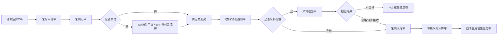
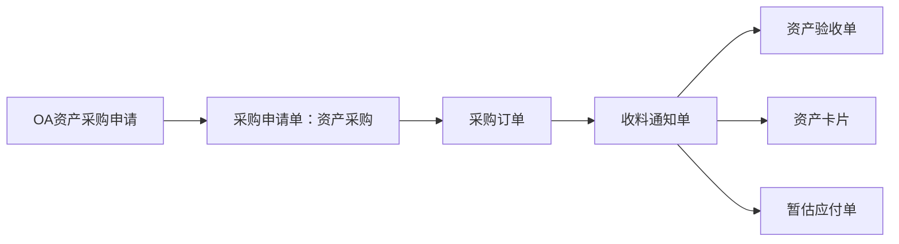
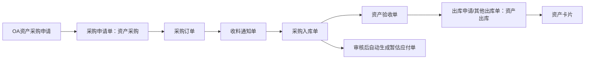
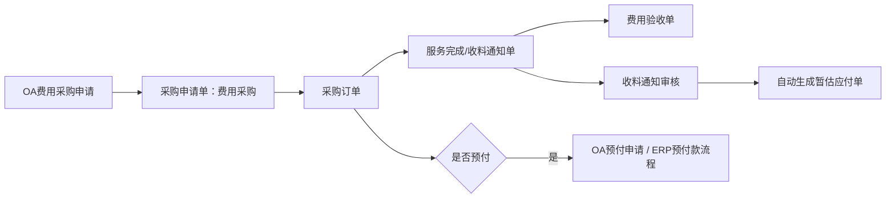
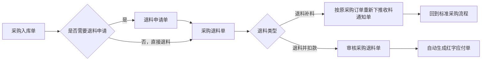

# 6. 采购管理模块梳理

> 梳理日期：2026-07-19  
> 项目目录：`/Users/dq/Documents/ERP/hub-erp-v0`  
> 参考蓝图：`/Users/dq/Documents/ERP/2606 金蝶云星空业务蓝图 V1.0.docx`  
> 参考设计文档：`/Users/dq/Documents/ERP/hub-erp-v0/多组织财务系统（私有部署）分模块详细设计文档（合集）.docx`  
> 参考字段目录：`/Users/dq/Documents/ERP/hub-erp-v0/traewordp/需求文件及参考单据字段`

---

## 1. 模块定位

采购管理是连接 **需求/OA/计划、供应商、质量、仓库、应付、资产、财务核算** 的核心业务模块。蓝图中采购管理模块编号为 **6. 采购管理**，流程主责部门为 **采购部**。

本模块需要覆盖：

1. 采购初始化与采购基础资料
2. 供应商信息联动
3. 采购申请
4. 采购订单
5. 采购订单变更
6. 收料/请检通知
7. 来料检验与不合格处置联动
8. 采购入库
9. 资产采购：入库、不入库两类
10. 费用采购：服务/费用类非实物采购
11. 采购退料申请
12. 采购退料单/补料/扣款
13. 采购对账
14. 采购价格、供应配额、采购报表分析
15. 与应付、预付、库存、质量、资产、OA、计划模块的数据接口

---

## 2. 蓝图流程清单

| 流程编号 | 流程名称 | 适用场景 | 核心输出 |
|---|---|---|---|
| CG-01 | 采购整体业务流程 | 采购模块总流程 | 模块全链路 |
| CG-06 | 标准采购流程 | 原材料、备品备件、低值易耗品等需要库存管理的物料 | 采购入库单、暂估应付单 |
| CG-07 | 资产采购流程（不入库） | 固定资产采购，不做库存管理 | 收料通知、资产验收、资产卡片、暂估应付单 |
| CG-08 | 资产采购流程（入库） | 固定资产采购，需要库存管理/在建工程 | 采购入库、资产验收、其他出库、资产卡片、暂估应付单 |
| CG-09 | 费用采购流程 | 服务、费用等非实物采购 | 收料/服务确认、费用验收、暂估应付单 |
| CG-10 | 采购退换货流程 | 采购物料入库后的退货、换货、扣款 | 退料申请、采购退料单、补料收料通知或红字应付单 |

---

## 3. 核心单据与业务对象

### 3.1 采购主链路单据

| 顺序 | 单据/对象 | 蓝图要求 | 关键字段/能力 |
|---:|---|---|---|
| 1 | 采购申请单 | 由计划运算投放或 OA 审批推送生成；区分标准采购、资产采购、费用采购 | 单据类型、申请组织、申请类型、申请日期、需求组织、采购组织、物料、单位、需求日期、申请数量 |
| 2 | 采购订单 | 由采购申请下推生成；录入采购合同号；可作为预付申请来源 | 采购组织、供应商、采购日期、业务类型、结算币别、付款条件、明细、交期、合同号、金额税额 |
| 3 | 收料/请检通知单 | 供应商到货后由采购订单下推；可进入来料检验或直接入库/验收 | 收料组织、供应商、采购组织、业务类型、结算组织、物料、收料数量、请检状态 |
| 4 | 来料检验单 | 对需检物料由收料通知下推；结果决定能否入库 | 合格、不合格、让步接收、免检、不合格处置 |
| 5 | 采购入库单 | 合格/让步/免检后由收料通知下推；审核后生成暂估应付 | 入库组织、仓库、货主、供应商、采购组织、物料、入库数量、批次、金额 |
| 6 | 应付单/暂估应付单 | 采购入库或收料确认后自动生成 | 来源单据、供应商、立账类型、金额、税额、币别、核算组织 |

### 3.2 扩展单据

| 单据/对象 | 使用场景 | 蓝图要求 |
|---|---|---|
| 采购订单变更单 | 已审核订单变更交期、数量、价格、供应商等 | 保留原订单关联，记录变更原因、变更类型、新旧值 |
| 采购退料申请单 | 需要退货申请时，由采购入库单下推 | 支持退料方式、退料类型、来源入库单 |
| 采购退料单 | 仓库实际退料，可由退料申请或采购入库单直接下推 | 退料补料时按源订单补料；退料扣款时生成红字应付单 |
| 采购对账单 | 与供应商核对入库、退料、发票、应付数据 | 支持供应商、币别、明细、对账状态 |
| 资产验收单 | 资产采购流程验收确认 | 不入库按收料通知验收；入库按采购入库验收 |
| 费用验收单 | 服务/费用采购完成确认 | 由收料通知下推，确认服务完成后生成应付 |
| 采购价格表/供应配额 | 价格控制、供应商配额管理 | 支持后续采购订单取价与供应商分配 |

---

## 4. 蓝图流程拆解

### 4.1 标准采购流程 CG-06

适用：原材料、备品备件、低值易耗品等需要库存管理的物料。



关键控制点：

- 采购申请可由计划/OA生成，也应支持手工新增。
- 采购申请下推采购订单时，需要反写申请单已采购数量。
- 采购订单下推收料通知时，需要反写订单已收料数量。
- 收料通知下推采购入库时，需要校验检验状态。
- 采购入库审核后，需要自动生成暂估应付单。

### 4.2 资产采购流程（不入库）CG-07

适用：固定资产采购，但不进库存。



关键控制点：

- 单据类型区分资产采购申请。
- 不产生采购入库单。
- 资产卡片由财务根据收料通知关联生成。
- 应付单由收料通知下推生成，立账类型为暂估应付。

### 4.3 资产采购流程（入库）CG-08

适用：固定资产采购并需要库存管理/在建工程。



关键控制点：

- 入库前同标准采购。
- 入库后需要资产验收和资产领用出库。
- 资产卡片依据其他出库单关联生成。
- 采购入库审核自动生成暂估应付。

### 4.4 费用采购流程 CG-09

适用：服务、费用等非实物采购。



关键控制点：

- 不产生库存入库。
- 收料通知实际承担服务完成确认的上游单据。
- 费用验收后才能生成应付或进入付款。

### 4.5 采购退换货流程 CG-10

适用：采购入库完成后的退货、换货、扣款。



关键控制点：

- 支持从采购入库单直接退料，也支持先生成退料申请。
- 退料数量不能超过可退数量。
- 退料补料需要保留原采购订单关系并重新收料。
- 退料扣款需要生成红字应付单。

---

## 5. 字段文档对采购模块的要求摘要

字段参考目录：`/Users/dq/Documents/ERP/hub-erp-v0/traewordp/需求文件及参考单据字段`

| 文件 | 对应对象 | 关键要求 |
|---|---|---|
| `供应商.txt` | 供应商 | 名称、创建组织、使用组织、结算币别、商务信息、财务信息、银行信息、组织信息、联系人 |
| `采购管理-初始化.txt` | 采购初始化 | 采购期初、初始化参数、初始化数据来源 |
| `采购管理-采购申请.txt` | 采购申请 | 单据类型、申请组织、申请类型、申请日期、物料、采购组织、需求组织、计价单位、申请单位、库存单位 |
| `采购管理-采购订单.txt` | 采购订单 | 采购日期、采购组织、供应商、业务类型、结算币别、物料、采购单位、计价单位、库存单位、付款计划、税务明细 |
| `采购管理-采购订单变更单.txt` | 订单变更 | 日期、变更原因、单据类型、业务类型、物料、变更类型、原订单编号、新需求组织 |
| `采购管理-收料请检通知单.txt` | 收料/请检 | 收料组织、收料日期、供应商、采购组织、业务类型、结算组织、物料、收料单位、计价单位、库存单位 |
| `采购管理-采购入库单.txt` | 采购入库 | 收料组织、入库日期、货主、采购组织、供应商、业务类型、物料、库存单位、计价单位、采购单位 |
| `采购管理--退料申请单.txt` | 退料申请 | 申请日期、采购组织、退料类型、申请组织、供应商、退料方式、业务类型、需求组织、币别、结算组织、物料 |
| `采购管理--退料单.txt` | 采购退料 | 退料组织、退料日期、货主、供应商、采购组织、退料类型、退料方式、业务类型、结算组织、币别、物料 |
| `采购管理-对账单.txt` | 采购对账 | 供应商、发起方类型、结算币别、本位币、物料、计价单位、对账明细 |
| `采购管理-报表分析.txt` | 报表分析 | 采购执行、订单执行、消耗、价格、供应配额等统计分析 |

字段层面的共性要求：

1. 需要支持多组织字段：申请组织、采购组织、需求组织、收料组织、库存组织、结算组织、货主组织等。
2. 需要支持表头 + 多明细行，而不是单据一行物料。
3. 需要支持税务明细、付款计划、交货计划、关联关系表。
4. 需要保留上下游来源关系，用于下推、反写、追溯和报表。
5. 需要支持不同业务类型：标准采购、资产采购、费用采购。

---

## 6. 当前代码现状

### 6.1 已有前端页面

目录：`/Users/dq/Documents/ERP/hub-erp-v0/traewordp/pages`

已存在的采购相关页面较全，包括：

- 采购申请：`purchase-request.html`、`purchase-request-create.html`
- 采购订单：`purchase-order.html`、`purchase-order-create.html`、`purchase-order-detail.html`
- 采购订单变更：`purchase-order-change.html`
- 收料/请检/检验：`purchase-receive.html`、`purchase-receive-create.html`、`purchase-inspect.html`、`purchase-inspect-create.html`、`purchase-inspect-notice-create.html`、`purchase-receive-inspect.html`、`purchase-receive-inspect-create.html`、`purchase-receive-inspect-list.html`
- 采购入库：`purchase-inbound.html`、`purchase-inbound-create.html`
- 退料申请/退料：`purchase-return-request.html`、`purchase-return-request-create.html`、`purchase-return.html`、`purchase-return-create.html`
- 对账/价格/报表/初始化/配额：`purchase-reconcile.html`、`purchase-reconcile-detail.html`、`purchase-reconcile-scheme.html`、`purchase-price-list.html`、`purchase-report.html`、`purchase-init.html`、`purchase-order-exec-summary.html`、`purchase-order-exec-detail.html`、`purchase-consume-summary.html`、`purchase-supply-quota.html`、`purchase-supply-quota-table.html`

当前判断：前端页面覆盖面较高，但大多偏原型/本地模拟，普遍使用 `localStorage`，尚未形成完整的后端 API 闭环。

### 6.2 已有后端模块/API

目录：`/Users/dq/Documents/ERP/hub-erp-v0/server/src/modules`

| 后端模块 | 现状 | 说明 |
|---|---|---|
| `purchase-request` | 已有 | 采购申请基础 CRUD、提交、审核、驳回、取消、关闭、已采购数量反写 |
| `purchase-order` | 已有 | 采购订单基础 CRUD、从采购申请生成订单、提交、审核、取消、关闭、统计 |
| `purchase` | 已有但未挂载到 `app.module.ts` | 采购综合统计控制器存在，但当前 `app.module.ts` 未导入 `PurchaseModule` |
| `supplier` | 已有 | 供应商基础资料 |
| `inventory-in` | 已有 | 可作为采购入库的基础，但不是完整采购入库模型 |
| `quality-inspection` | 已有 | 可作为来料检验基础，但未与收料通知/采购链路打通 |
| `payable` | 已有 | 应付模块存在，但采购自动暂估/红字应付联动需补齐 |
| `fixed-asset` | 已有 | 固定资产模块存在，但资产采购自动生成资产卡片联动需补齐 |

当前 Swagger 可用相关路径包括：

- `/api/suppliers`
- `/api/purchase-request`
- `/api/purchase-orders`
- `/api/inventory-in`
- `/api/quality-inspections`
- `/api/payables`
- `/api/fixed-asset`

### 6.3 后端实体简况

| 实体文件 | 当前形态 | 主要问题 |
|---|---|---|
| `/Users/dq/Documents/ERP/hub-erp-v0/server/src/database/entities/purchase-request.entity.ts` | 单行明细式采购申请 | 缺表头/明细拆分，缺申请类型、采购组织、需求组织、库存单位、单据类型等完整字段 |
| `/Users/dq/Documents/ERP/hub-erp-v0/server/src/database/entities/purchase-order.entity.ts` | 单行明细式采购订单 | 缺订单明细表、交货计划、税务明细、付款计划、合同号、采购组织/结算组织等完整字段 |
| `/Users/dq/Documents/ERP/hub-erp-v0/server/src/database/entities/inventory-in.entity.ts` | 通用入库单 | 可复用但需补采购入库业务字段和来源关系 |
| `/Users/dq/Documents/ERP/hub-erp-v0/server/src/database/entities/quality-inspection.entity.ts` | 通用质量检验 | 需与收料通知单、采购入库准入规则联动 |
| `/Users/dq/Documents/ERP/hub-erp-v0/server/src/database/entities/payable.entity.ts` | 应付基础单据 | 需支持采购暂估应付、费用应付、资产应付、红字应付来源生成 |
| `/Users/dq/Documents/ERP/hub-erp-v0/server/src/database/entities/fin-fixed-asset.entity.ts` | 固定资产卡片 | 需补采购来源关联和资产验收/出库生成规则 |
| `/Users/dq/Documents/ERP/hub-erp-v0/server/src/database/entities/supplier.entity.ts` | 供应商基础档案 | 较字段文档仍缺组织/商务/财务/银行/联系人分录结构 |

---

## 7. 蓝图要求与现有实现差距

| 蓝图/字段要求 | 当前实现 | 差距 | 优先级 |
|---|---|---|---|
| 采购申请支持标准/资产/费用采购申请 | 有采购申请基础 CRUD | 缺申请类型/单据类型驱动流程分支；字段不完整；前端未真实接 API | P0 |
| 采购申请下推采购订单 | 后端已有 `createFromRequest` | 当前生成订单只有表头，未生成多行明细；反写逻辑简单；不支持部分采购 | P0 |
| 采购订单提交/审核/关闭 | 已有基础状态流 | 缺合同号、交期计划、付款计划、税务、明细行、数量状态 | P0 |
| 采购订单下推收料通知 | 前端有页面 | 后端缺收料通知单实体/API/下推逻辑 | P0 |
| 收料通知下推来料检验 | 有质量检验模块 | 缺采购收料与检验的来源关系和状态控制 | P1 |
| 检验合格/让步/免检后入库 | 有入库模块 | 缺检验结果控制入库；缺收料通知下推入库 | P1 |
| 采购入库审核生成暂估应付 | 有库存入库和应付模块 | 缺审核触发自动生成暂估应付；缺来源单据追溯 | P0 |
| 采购订单变更 | 前端有页面/字段文档有要求 | 后端缺订单变更实体/API/变更生效逻辑 | P2 |
| 采购退料申请 | 前端有页面/字段文档有要求 | 后端缺实体/API/从入库下推 | P2 |
| 采购退料单 | 前端有页面/字段文档有要求 | 后端缺实体/API；缺补料/扣款分支；缺红字应付 | P2 |
| 费用采购 | 蓝图明确 | 缺费用采购流程分支、费用验收单、收料审核生成应付 | P3 |
| 资产采购入库/不入库 | 蓝图明确 | 缺资产验收单、资产卡片自动关联生成、其他出库联动 | P3 |
| 采购对账 | 前端有页面/字段文档有要求 | 后端缺对账单实体/API/对账生成规则 | P4 |
| 采购价格/供应配额/报表 | 前端有页面 | 缺真实数据来源和统计 API | P4 |
| 多组织字段 | 部分实体只有 `orgId` | 缺申请组织、采购组织、需求组织、库存组织、结算组织、货主等完整建模 | P0 |
| 单据表头+多明细 | 当前采购申请/订单均为单行明细式 | 不符合蓝图和金蝶字段结构；影响下推/反写/统计 | P0 |
| 上下游关联关系 | 只有简单 `sourceId/sourceNo` | 缺单据级和明细级来源关系表；无法完整追溯 | P0 |

---

## 8. 建议实施边界：先完成标准采购最小闭环

用户现在要“单独完成采购管理模块”，建议不要一次性铺开所有子流程。应先把 **标准采购闭环** 做真实，再扩展资产、费用、退换货、对账和报表。

### 8.1 P0：标准采购最小可用闭环

目标：打通 **采购申请 → 采购订单 → 收料通知 → 采购入库 → 暂估应付**。

必须完成：

1. 采购申请
   - 列表接后端 API
   - 新增/编辑/删除
   - 提交/审核/驳回/取消/关闭
   - 支持多明细或至少为后续多明细预留结构
   - 支持单据类型：标准采购、资产采购、费用采购

2. 采购订单
   - 列表接后端 API
   - 新增/编辑/提交/审核/关闭/取消
   - 从采购申请下推生成采购订单
   - 反写采购申请已采购数量
   - 补合同号、采购组织、结算组织、币别、供应商等核心字段

3. 收料通知单
   - 新增后端实体/API
   - 支持从采购订单下推
   - 支持收料数量反写采购订单已收料数量
   - 支持免检/需检标识

4. 采购入库单
   - 优先复用或扩展 `inventory-in`，明确 `sourceType = PURCHASE_RECEIVE`
   - 支持从收料通知下推
   - 支持审核入库
   - 反写订单已入库数量/收料通知已入库数量

5. 暂估应付
   - 入库审核后自动生成应付单
   - 应付单来源关联采购入库单
   - 立账类型：暂估应付
   - 价税合计、币别、供应商、核算组织要可追溯

6. 前端改造
   - 采购申请、采购订单、收料通知、采购入库页面从 `localStorage` 改为 API 调用
   - 保留原型 UI，不大改样式，先保证业务闭环

### 8.2 P1：补齐质量链路

目标：采购收料后支持来料检验。

- 收料通知下推来料检验单。
- 检验结果：合格、不合格、让步接收。
- 合格/让步/免检允许入库。
- 不合格进入不合格处置，不允许直接入库或只能按让步数量入库。

### 8.3 P2：采购退换货

目标：打通退货、补料、扣款。

- 采购入库单下推退料申请单。
- 退料申请单下推采购退料单。
- 支持采购入库单直接下推采购退料单。
- 退料补料：按原采购订单重新生成收料通知。
- 退料扣款：采购退料审核后自动生成红字应付单。

### 8.4 P3：资产采购与费用采购

目标：覆盖蓝图 CG-07、CG-08、CG-09。

- 资产采购不入库：采购申请 → 采购订单 → 收料通知 → 资产验收 → 资产卡片/暂估应付。
- 资产采购入库：采购申请 → 采购订单 → 收料通知 → 采购入库 → 资产验收 → 其他出库 → 资产卡片/暂估应付。
- 费用采购：采购申请 → 采购订单 → 收料通知/服务完成 → 费用验收 → 暂估应付。

### 8.5 P4：对账、价格、配额、报表

目标：完善采购经营分析与供应商协同。

- 采购对账单
- 采购价格表
- 供应配额
- 采购订单执行汇总/明细
- 采购消耗汇总
- 采购报表分析
- 采购初始化

---

## 9. 建议的数据模型调整

### 9.1 推荐采用“表头 + 明细 + 来源关系”的单据模型

当前采购申请和采购订单实体是“一张单据一行物料”的结构。若要贴近蓝图，建议后续演进为：

```text
purchase_requests              采购申请表头
purchase_request_entries       采购申请明细
purchase_orders                采购订单表头
purchase_order_entries         采购订单明细
purchase_receipts              收料/请检通知表头
purchase_receipt_entries       收料/请检通知明细
purchase_inbounds              采购入库表头，或扩展 inventory_in
purchase_inbound_entries       采购入库明细
purchase_return_requests       退料申请表头
purchase_return_request_entries退料申请明细
purchase_returns               采购退料表头
purchase_return_entries        采购退料明细
purchase_reconciliations       采购对账表头
purchase_reconciliation_entries采购对账明细
bill_relations                 单据/明细来源关系通用表，可选
```

### 9.2 关键公共字段

所有采购单据建议统一具备：

- `billNo`：单据编号
- `billType`：单据类型：标准、资产、费用等
- `businessType`：业务类型
- `status`：草稿、待审核、已审核、已关闭、已取消等
- `applicationOrgId`：申请组织
- `purchaseOrgId`：采购组织
- `requireOrgId`：需求组织
- `stockOrgId`：库存/收料组织
- `settleOrgId`：结算组织
- `ownerType` / `ownerId`：货主类型/货主
- `supplierId`：供应商
- `currencyId`：币别
- `sourceBillType` / `sourceBillId` / `sourceBillNo`
- `sourceEntryId`：来源明细 ID
- `remark`
- `createdBy` / `approvedBy` / `approvedAt`

### 9.3 数量反写字段

采购明细建议维护：

- 申请数量
- 已采购数量
- 订单数量
- 已收料数量
- 已请检数量
- 已合格数量
- 已入库数量
- 已退料数量
- 可下推数量
- 可关闭数量

---

## 10. 后续开发建议顺序

建议按下面顺序开工，风险最低：

1. **确认采购模块目标边界**：先做 P0 标准采购闭环。
2. **补后端缺口**：新增收料通知实体/API；扩展采购订单/采购申请字段；补入库审核生成暂估应付。
3. **打通下推动作**：申请下推订单、订单下推收料、收料下推入库、入库审核生成应付。
4. **改前端接 API**：先改采购申请、采购订单、收料通知、采购入库四组页面。
5. **加流程状态与数量反写**：保证每一步数据可追溯、可关闭。
6. **再扩展 P1/P2/P3/P4**：质量、退料、资产/费用、对账报表。

---

## 11. 本轮结论

采购模块文档和页面已经具备较完整的“原型覆盖”，但当前代码更接近“采购申请 + 采购订单基础 CRUD + 多页面 localStorage 原型”。若要按蓝图完成采购管理模块，应优先把标准采购链路做成真实闭环：

> 采购申请 → 采购订单 → 收料/请检通知 → 采购入库 → 自动暂估应付

这条链路完成后，再补质量检验、退换货、资产采购、费用采购、对账和报表，整体采购模块才能从页面原型升级为可运行业务模块。
